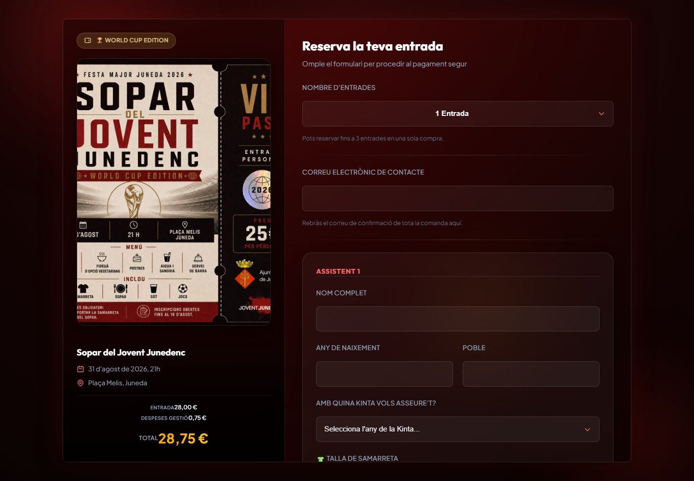
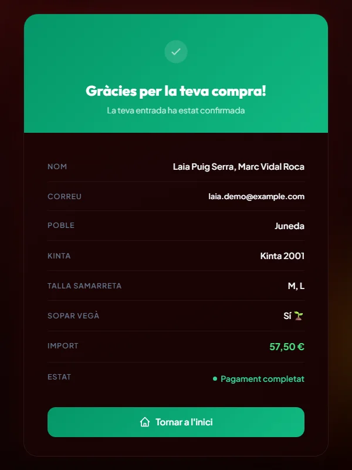
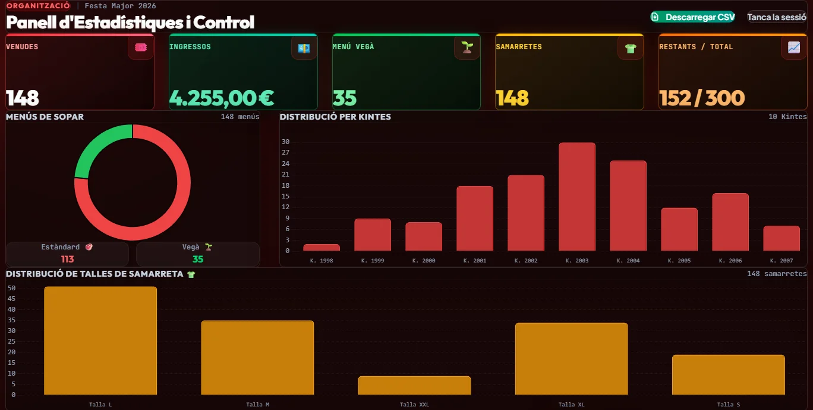
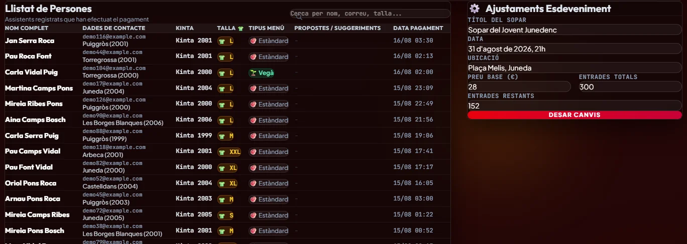
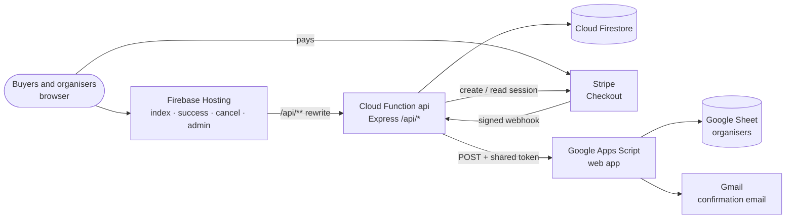
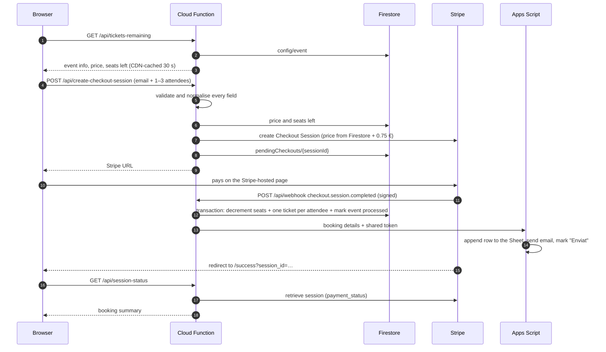
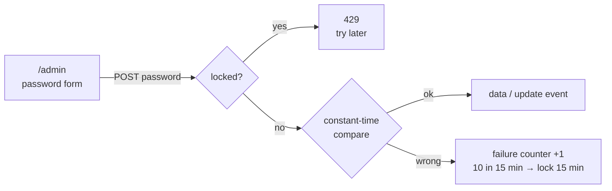
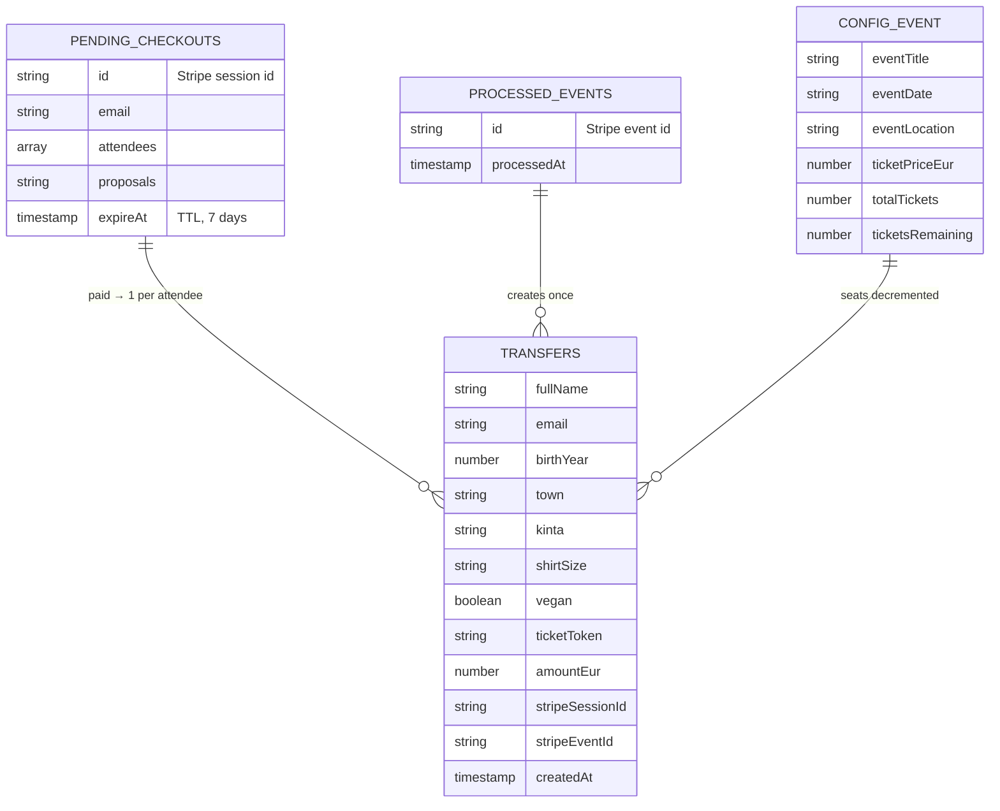

<div align="center">

# Sopar del Jovent Junedenc · Ticketing

**Ticket sales for a 300-seat community dinner in Juneda (Catalonia): Stripe Checkout, automatic confirmation emails, a Google Sheet for the organisers and a live stats dashboard.**

[](https://joventjunedenc-9ead8.web.app)


[](LICENSE)

</div>

> **Resum en català** — Sistema de venda d'entrades fet per al Sopar del Jovent Junedenc de la Festa Major de Juneda 2026 (300 places, unes dues setmanes de venda). Cada compra pot incloure d'1 a 3 assistents, amb la seva *kinta*, talla de samarreta i menú vegà. El pagament es fa amb Stripe Checkout; en confirmar-se, un webhook descompta les places a Firestore, afegeix una fila al full de Google de l'organització i envia el correu de confirmació des del Gmail del jovent. L'organització disposa d'un panell protegit amb estadístiques, gràfics, cercador i exportació CSV. Tot funciona amb els plans gratuïts; l'únic cost és la comissió de Stripe, coberta per unes despeses de gestió de 0,75 € per entrada.

<p align="center">
  
</p>

<table>
  <tr>
    <td width="50%" align="center"></td>
    <td width="50%" align="center"></td>
  </tr>
  <tr>
    <td align="center"><sub>Confirmation page, checked against Stripe on the server</sub></td>
    <td align="center"><sub>Mobile-first booking page</sub></td>
  </tr>
</table>

<p align="center">
  <br />
  <sub>Organisers' dashboard (screenshots of the success page and dashboard use demo data)</sub>
</p>

## What it does

The organisers of the youth dinner (*Sopar del Jovent*) needed to sell 300 seats online, collect per-person details for seating and T-shirts, and keep an up-to-date list in a Google Sheet, without paying for a ticketing platform. This project covers the whole flow, from the public booking page to the organisers' spreadsheet.

### Public site

- Event poster, date, place and a live **remaining seats** counter (shows *Exhaurit* and disables the form when sold out).
- One purchase covers **1 to 3 attendees**. For each one: full name, birth year, town, *kinta* (the year group they want to sit with), T-shirt size (S–XXL or a custom one) and vegan menu.
- Price breakdown per ticket: base price + **0.75 € management fee**, which covers Stripe's fee.
- Payment on **Stripe Checkout** (hosted page, card payments).
- `/success` page that asks the server for the real payment status and shows the booking summary with confetti; `/cancel` page if the buyer backs out.
- Confirmation email in Catalan, sent from the organisers' own Gmail.

### Admin dashboard

`/admin` is protected by a password and lets the organisers:

- See tickets sold, revenue, vegan menus, T-shirts and remaining/total seats.
- Read charts of menus (standard vs vegan), attendees per *kinta* and T-shirt sizes.
- Search the attendee list by name, email, town, *kinta* or size.
- Change the event title, date, place, base price, total seats and remaining seats.
- Export everything to **CSV** (UTF-8 with BOM and `;` separators, so it opens directly in Excel).

<details>
<summary>Attendee list and event settings</summary>



</details>

### Organisers' Google Sheet

Every paid booking becomes a row in the organisers' sheet (date, names, email, birth years, ages, towns, *kintas*, sizes, vegan menus, suggestions and email status). The sheet also gets a **Sopar Festa Major → Enviar correus pendents** menu, which sends the confirmation email to rows that were added by hand (for example, cash sales) and marks them as *Enviat*.

## Tech stack

| Layer | Technology |
|---|---|
| Frontend | Static **HTML** + vanilla JS, **Tailwind CSS 4** (browser build), custom CSS, **Chart.js 4** for the dashboard |
| Backend | **Firebase Cloud Functions v2** (Node.js 20) running one **Express** app, region `europe-west1` |
| Database | **Cloud Firestore**: event config, pending checkouts, tickets, webhook idempotency log, admin lockout |
| Hosting | **Firebase Hosting** with clean URLs; `/api/**` is rewritten to the function |
| Payments | **Stripe Checkout** + signed webhooks, with a restricted API key |
| Automation | **Google Apps Script** web app as a bridge to **Google Sheets** and **Gmail** |
| Secrets | **Firebase Secret Manager** and Apps Script *Script Properties* |

## Architecture



The site is four static pages. All logic lives in a single Cloud Function (`api`) that serves six endpoints. The browser never writes to Firestore, never sees a secret, and never sends a price.

### Buying tickets



1. The booking page loads the event data from `/api/tickets-remaining`. The response is cached by the Hosting CDN for 30 seconds, so a burst of visitors does not hit Firestore on every page view.
2. `/api/create-checkout-session` checks every field (lengths, birth year, 4-digit *kinta*, allow-listed shirt size, valid email) and keeps only known fields. It then reads the **price and the remaining seats from Firestore**: whatever the browser shows is only a preview.
3. The function creates a Stripe Checkout Session and stores the attendees under `pendingCheckouts/{sessionId}`, with an `expireAt` date so a TTL policy deletes abandoned checkouts after 7 days. Redirect URLs are only built from an allow-list of origins.
4. When the buyer pays, Stripe calls `/api/webhook`. The signature is verified with `stripe.webhooks.constructEvent` before anything else happens.
5. A single **Firestore transaction** checks there are still enough seats, decrements `ticketsRemaining`, creates one document in `transfers` per attendee (with a random `ticketToken`) and records the Stripe event id in `processedEvents`. If Stripe sends the same event again, it is skipped.
6. The function then posts the booking to Apps Script with a shared token. Apps Script appends the row to the Sheet, sends the email and marks the row as sent. If this step fails, the tickets are already stored, so the error is only logged; the organisers can still send the email from the Sheet menu.
7. The `/success` page calls `/api/session-status`, which asks Stripe for the session and only shows the confirmation when `payment_status` is `paid`. If the webhook has not arrived yet, it builds the summary from the pending checkout.

### Admin access



There are no user accounts: one password, stored as a Firebase secret, protects both admin endpoints. The browser keeps it in `sessionStorage` (cleared when the tab closes) and sends it with every request. Failed attempts are counted in `adminAuth/throttle`; the lockout is global on purpose, because the client controls `X-Forwarded-For` and per-IP limits could be bypassed.

## Data model



| Collection | Written by | Purpose |
|---|---|---|
| `config/event` | Admin endpoint, seed script | Event info, base price and seat counter. The only document clients can read. |
| `pendingCheckouts/{sessionId}` | `create-checkout-session` | Attendee details while the buyer is on Stripe. Deleted by TTL after 7 days. |
| `transfers/{id}` | Webhook | One paid ticket per attendee. Source for the dashboard and the CSV. |
| `processedEvents/{eventId}` | Webhook | Idempotency log, so Stripe retries never issue tickets twice. |
| `adminAuth/throttle` | Admin endpoints | Failed login counter and lockout. |

## API

| Method | Route | Access | Description |
|---|---|---|---|
| `GET` | `/api/tickets-remaining` | Public | Event info, base price and seats left. CDN-cached for 30 s. |
| `POST` | `/api/create-checkout-session` | Public | Validates the booking and returns the Stripe Checkout URL. |
| `GET` | `/api/session-status?session_id=` | Public | Payment status and booking summary for `/success`. |
| `POST` | `/api/webhook` | Stripe only (signature) | Handles `checkout.session.completed`. |
| `POST` | `/api/admin/transfers` | Admin password | All tickets plus the event config. |
| `POST` | `/api/admin/update-event` | Admin password | Updates title, date, place, price and seat counts (validated). |

## Security design

- **No card data touches the app.** Payment happens entirely on Stripe's hosted, PCI-compliant checkout.
- **Server-side pricing.** The price comes from Firestore and the quantity is capped at 1–3, so clients cannot change the amount.
- **Least-privilege Stripe key.** The function uses a restricted key that only has `Checkout Sessions: Write`.
- **Webhook integrity.** Every webhook is checked with `stripe.webhooks.constructEvent` before any state changes. Processed event ids are stored, so Stripe retries have no effect.
- **Atomic inventory.** The seat decrement and the ticket records are written in a single Firestore transaction, which re-checks availability and prevents overselling the counter.
- **Strict input validation.** Lengths are capped, *kinta* and shirt-size values are allow-listed, and only known fields are stored.
- **Safe redirects.** Stripe success and cancel URLs are only built from an allow-list of origins.
- **Output encoding everywhere.** HTML is escaped in the emails and the admin table. Spreadsheet formula and CSV injection are neutralised in Google Sheets and in the CSV export.
- **Admin hardening.** The password is compared in constant time (SHA-256 + `timingSafeEqual`) with a global lockout after repeated failures. It lives only in `sessionStorage`, and there is no destructive "wipe" endpoint over HTTP.
- **Locked-down Firestore rules.** Clients can only read `config/*`. Everything else is denied and reachable only through the Admin SDK.
- **Authenticated bridge.** Apps Script rejects every request whose token does not match its `SECURITY_TOKEN` property, and rejects everything if the property is missing.
- **Secrets out of the code.** Firebase Secret Manager holds the backend credentials and Apps Script *Script Properties* hold the bridge token.

## Project structure

```text
public/                     Static site served by Firebase Hosting
  index.html                Booking page (poster, price, attendee forms)
  success.html              Payment confirmation
  cancel.html               Payment cancelled
  admin.html                Organisers' dashboard (Chart.js, CSV export)
  css/custom.css            Red-and-gold theme on top of Tailwind
functions/
  index.js                  Express app exported as the `api` Cloud Function
apps-script/codigo.gs       Google Sheets + Gmail bridge (paste into Apps Script)
scripts/clear-test-data.js  Local-only reset of test data and production config
firestore.rules             Security rules (read-only event config, deny all else)
firebase.json               Hosting, rewrites, cache headers and functions config
.env.example                List of the required secrets
docs/screenshots/           Images used in this README
```

## Setup and deployment

### Requirements

- Node.js 20 and the Firebase CLI.
- A Firebase project on the **Blaze** plan (required by Cloud Functions v2).
- A Stripe account.
- A Google account with a Google Sheet for the organisers.

### 1. Firebase project

```bash
firebase login
firebase use --add            # select your project (writes .firebaserc)
```

Enable Firestore (preferably in `europe-west1`).

### 2. Seed the event configuration

Create the document `config/event` in Firestore:

| Field | Example |
|---|---|
| `eventTitle` | `Sopar de Festa Major` |
| `eventDate` | `31 d'agost de 2026, 21h` |
| `eventLocation` | `Plaça Major` |
| `ticketPriceEur` | `28` |
| `totalTickets` | `300` |
| `ticketsRemaining` | `300` |

### 3. Google Sheets and Apps Script

1. Create a Google Sheet, then open **Extensions → Apps Script** and paste [`apps-script/codigo.gs`](apps-script/codigo.gs).
2. Go to **Project Settings → Script Properties** and add `SECURITY_TOKEN`. Generate the value with `openssl rand -hex 32`.
3. Go to **Deploy → New deployment → Web app**. Set *Execute as*: **Me** and *Who has access*: **Anyone**. The token is what authenticates the caller.
4. Copy the web app URL. After any change to the script, publish a new version of the deployment.

### 4. Secrets

```bash
firebase functions:secrets:set STRIPE_SECRET_KEY         # restricted key, Checkout Sessions: Write
firebase functions:secrets:set STRIPE_WEBHOOK_SECRET
firebase functions:secrets:set APPS_SCRIPT_WEB_APP_URL
firebase functions:secrets:set APPS_SCRIPT_SECRET_TOKEN  # same value as SECURITY_TOKEN
firebase functions:secrets:set ADMIN_PASSWORD
```

| Secret | Used for |
|---|---|
| `STRIPE_SECRET_KEY` | Creating and reading Checkout Sessions. |
| `STRIPE_WEBHOOK_SECRET` | Verifying webhook signatures. |
| `APPS_SCRIPT_WEB_APP_URL` | The `/exec` URL of the Apps Script web app. If empty, the Sheet and email step is skipped. |
| `APPS_SCRIPT_SECRET_TOKEN` | Shared secret, must match the `SECURITY_TOKEN` script property. |
| `ADMIN_PASSWORD` | Password for `/admin`. Use a different value from the bridge token. |

See [`.env.example`](.env.example) for the reference list. Never commit real values.

### 5. Deploy

```bash
cd functions && npm install && cd ..
firebase deploy
```

In Stripe, add a webhook endpoint for `checkout.session.completed` pointing to `https://<region>-<project-id>.cloudfunctions.net/api/webhook`.

### 6. Recommended hardening

```bash
# Auto-delete abandoned checkouts after 7 days (TTL on the expireAt field)
gcloud firestore fields ttls update expireAt --collection-group=pendingCheckouts --enable-ttl
```

Also set a **budget alert** in Google Cloud Billing.

## Local development

```bash
firebase emulators:start
stripe listen --forward-to http://localhost:5001/<project-id>/europe-west1/api/webhook
```

For the emulator, put the secrets in `functions/.secret.local` (ignored by Git).

Stripe test cards:

| Card | Result |
|---|---|
| `4242 4242 4242 4242` | Success |
| `4000 0000 0000 0002` | Declined |
| `4000 0025 0000 3155` | 3-D Secure |

To reset test data, run `GCLOUD_PROJECT=<project-id> node scripts/clear-test-data.js`. It deletes `transfers`, `pendingCheckouts` and `processedEvents` and resets `config/event` to the production values. It needs local Firebase credentials and is intentionally not exposed over HTTP.

## Design notes

- **Seats are reserved when payment is confirmed, not when checkout starts.** Availability is checked before creating the Stripe session and checked again inside the webhook transaction. For a 300-seat dinner this keeps the system simple; the trade-off is that if the last seats sell out while someone is on the Stripe page, that payment fails in the webhook and has to be refunded by hand.
- **The Sheet and the email are best-effort.** The tickets in Firestore are the source of truth. If Google is down, nothing is lost: the dashboard still shows the ticket, and the email can be sent later from the Sheet menu.
- **Free tiers only.** Firebase, Firestore, Apps Script and Gmail stay within free quotas for an event of this size. Stripe's fee is the only cost, and the 0.75 € management fee per ticket covers it.

## Author and license

Design and development: **Gerard Barrufet Segarra** ([@Barru23](https://github.com/Barru23)).

The source code is published for portfolio and reference purposes, with all rights reserved: see [`LICENSE`](LICENSE). The event poster (`public/poster-sopar-2026.jpeg`) and event branding belong to the event organisers.

---

<p align="center"><b>Festa Major de Juneda 2026 · World Cup Edition</b></p>
