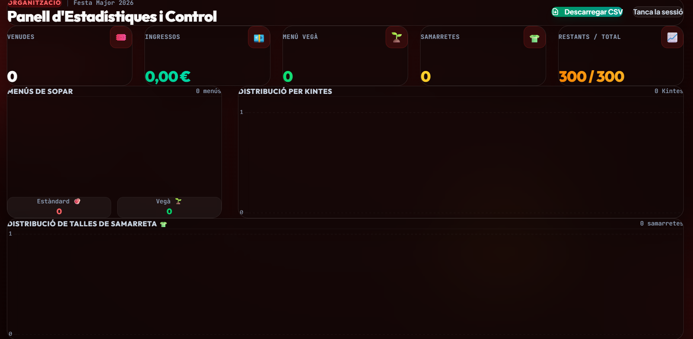

# 🎟️ Event Ticketing — Stripe Checkout on Firebase

A production ticketing system I built for a local community dinner in Catalonia (300 seats, ~2 weeks of sales). Buyers register 1–3 attendees, pay with Stripe Checkout, and automatically get a confirmation email and a row in the organisers' Google Sheet. Organisers get a password-protected dashboard with live stats, charts and a CSV export.

Everything runs on free tiers. The only cost is Stripe's per-transaction fee, which a small management fee on each ticket passes on to the buyer.



---

## 🛠️ Tech Stack

| Layer | Technology |
| :--- | :--- |
| Frontend | Static HTML + Tailwind CSS v4 (browser build), vanilla JS, Chart.js |
| Backend | Firebase Cloud Functions v2 (Node.js 20, Express) |
| Database | Cloud Firestore (inventory, purchases, idempotency log) |
| Hosting | Firebase Hosting (rewrites `/api/**` to the function) |
| Payments | Stripe Checkout + signed webhooks |
| Automation | Google Apps Script web app → Google Sheets + Gmail |

---

## 🏗️ Architecture

```
Browser (index.html)
  │
  ├── GET  /api/tickets-remaining ─► Cloud Function ─► Firestore (config/event)   [CDN-cached 30 s]
  │
  ├── POST /api/create-checkout-session ─► validate input ─► Stripe Checkout Session
  │        └── redirect to Stripe-hosted payment page
  │
  └── Payment completed
        ├── redirect ─► success.html ─► GET /api/session-status
        └── Stripe webhook ─► POST /api/webhook
                 ├── verify Stripe signature
                 ├── idempotency check (processedEvents)
                 ├── Firestore transaction: decrement stock + create purchase records
                 └── POST (shared secret) ─► Google Apps Script
                          ├── append row to Google Sheet (formula-injection safe)
                          └── send confirmation email via Gmail (HTML-escaped)
```

---

## 🔒 Security Design

- **No card data touches the app.** Payment happens entirely on Stripe's hosted, PCI-compliant checkout.
- **Server-side pricing.** The price comes from Firestore and the quantity is capped at 1–3, so clients cannot change the amount.
- **Least-privilege Stripe key.** The function uses a restricted key that only has `Checkout Sessions: Write`.
- **Webhook integrity.** Every webhook is checked with `stripe.webhooks.constructEvent` before any state changes. Processed event IDs are stored, so Stripe retries have no effect.
- **Atomic inventory.** The stock decrement and the purchase records are written in a single Firestore transaction, which prevents overselling.
- **Strict input validation.** Lengths are capped, kinta and shirt-size values are allow-listed, and only known fields are stored.
- **Output encoding everywhere.** HTML is escaped in the emails and the admin table. Spreadsheet formula and CSV injection are neutralised in Google Sheets and in the CSV export.
- **Admin hardening.** The admin password is compared in constant time with a global lockout after repeated failures. It lives only in `sessionStorage`, and there is no destructive "wipe" endpoint over HTTP.
- **Locked-down Firestore rules.** Clients can only read the public event config. Everything else is reachable only through the Admin SDK.
- **Secrets in Secret Manager.** Firebase secrets hold the backend credentials, and Apps Script *Script Properties* hold the bridge token. No secrets are in source code.

---

## 🚀 Setup & Deployment

### 1. Firebase project
```bash
firebase login
firebase use --add            # select your project (writes .firebaserc)
```
Enable Firestore (preferably in `europe-west1`).

### 2. Seed the event configuration
Create the document `config/event` in Firestore:

| Field | Example |
| :--- | :--- |
| `eventTitle` | `Sopar de Festa Major` |
| `eventDate` | `31 d'agost de 2026, 21h` |
| `eventLocation` | `Plaça Major` |
| `ticketPriceEur` | `28` |
| `totalTickets` | `300` |
| `ticketsRemaining` | `300` |

### 3. Google Sheets & Apps Script
1. Create a Google Sheet, then open **Extensions → Apps Script** and paste [`apps-script/codigo.gs`](apps-script/codigo.gs).
2. Go to **Project Settings → Script Properties** and add `SECURITY_TOKEN`. Generate the value with `openssl rand -hex 32`.
3. Go to **Deploy → New deployment → Web app**. Set *Execute as*: **Me** and *Who has access*: **Anyone**. The token is what authenticates the caller.
4. Copy the web app URL.

### 4. Secrets
```bash
firebase functions:secrets:set STRIPE_SECRET_KEY         # restricted key, Checkout Sessions: Write
firebase functions:secrets:set STRIPE_WEBHOOK_SECRET
firebase functions:secrets:set APPS_SCRIPT_WEB_APP_URL
firebase functions:secrets:set APPS_SCRIPT_SECRET_TOKEN  # same value as SECURITY_TOKEN
firebase functions:secrets:set ADMIN_PASSWORD
```
See [`.env.example`](.env.example) for the full list.

### 5. Deploy
```bash
cd functions && npm install && cd ..
firebase deploy
```
In Stripe, add a webhook endpoint for `checkout.session.completed` pointing to `https://<region>-<project-id>.cloudfunctions.net/api/webhook`.

### 6. Recommended hardening
```bash
# Auto-delete abandoned checkouts after 7 days (TTL on the expireAt field)
gcloud firestore fields ttls update expireAt --collection-group=pendingCheckouts --enable-ttl
```
Also set a **budget alert** in Google Cloud Billing. Cloud Functions v2 requires the Blaze plan.

---

## 🧪 Local Development

```bash
firebase emulators:start
stripe listen --forward-to http://localhost:5001/<project-id>/europe-west1/api/webhook
```

Stripe test cards:

| Card | Result |
| :--- | :--- |
| `4242 4242 4242 4242` | Success |
| `4000 0000 0000 0002` | Declined |
| `4000 0025 0000 3155` | 3-D Secure |

To reset test data, run `GCLOUD_PROJECT=<project-id> node scripts/clear-test-data.js`. This needs local Firebase credentials and is intentionally not exposed over HTTP.

---

## 📄 License

The source code is released under the [MIT License](LICENSE).
The event poster (`public/poster-sopar-2026.jpeg`) and event branding belong to the event organisers and are **not** covered by the license.
